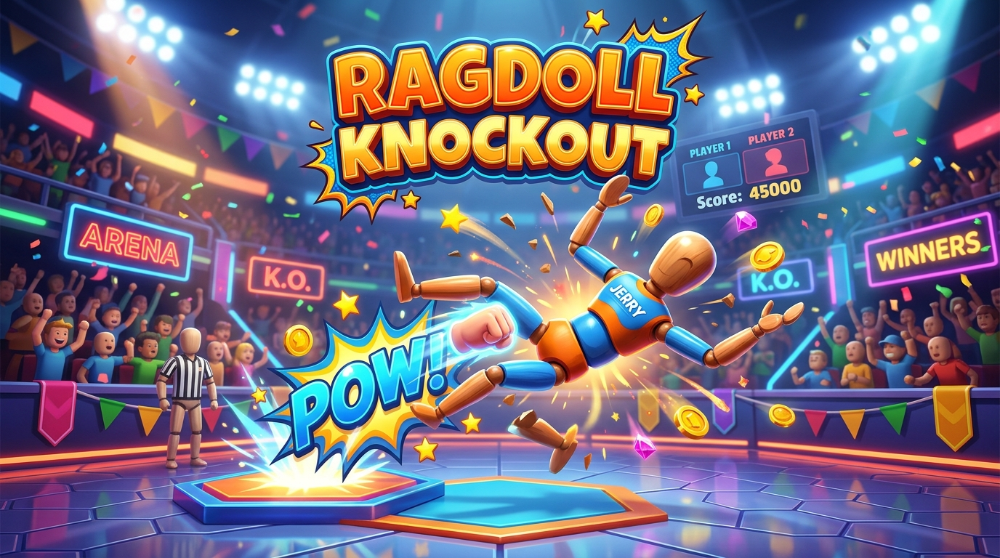

# 🥊 Ragdoll Knockout

<div align="center">



**A high-energy, 3D physics-based ragdoll knockout and ricochet arcade game built with Babylon.js and Havok Physics WASM.**

[](https://www.babylonjs.com/)
[](https://www.havok.com/)
[](https://www.typescriptlang.org/)
[](https://vitejs.dev/)
[](https://support.google.com/youtube/answer/13831872)
[](https://ragdoll-knockout.pages.dev)
[](LICENSE)

[🎮 Key Features](#-key-features) • [🚀 Getting Started](#-getting-started) • [🕹️ Controls & Gameplay](#️-controls--gameplay) • [🏗️ Architecture](#️-project-architecture) • [🛠️ Level Editor](#️-built-in-level-editor) • [🌐 Deployment](#-deployment)

</div>

---

## 🌟 Overview

**Ragdoll Knockout** is an action-packed 3D physics arcade game where players aim, bounce bullets off obstacles, and knock out quirky ragdoll characters and comical chickens across dynamic puzzle levels. Built with high-fidelity Havok Physics compiled to WebAssembly (WASM), every projectile trajectory, ricochet bounce, and ragdoll impact calculates realistic force impulses in real-time.

Designed for instant play on mobile and desktop, the game is fully compliant with the YouTube Playables platform requirements, supporting responsive scaling, audio lifecycle management, cloud saves, and multi-language internationalization (i18n).

---

## ✨ Key Features

- **⚡ High-Fidelity Havok Physics (WASM)**: Powered by `@babylonjs/havok` WASM, delivering realistic multi-joint ragdoll skeleton collapses, realistic tumbling, dynamic joint stiffness, and impulse reactions.
- **🎯 Ricochet & Ballistics Engine**: Custom bullet physics with bounce decay, trajectory prediction, and continuous collision detection (CCD) against walls, obstacles, and targets.
- **🐔 Comical Target Entities**: Dynamic enemy types including humanoid ragdoll dummies and animated physics-reactive chickens (`chicken.glb`) with custom death and impact animations.
- **📺 YouTube Playables Ready**: Production-grade compliance with YouTube Playables SDK v1:
  - Immediate `firstFrameReady()` dispatch.
  - Lifecycle pause/resume synchronization.
  - Audio management responding to platform visibility state.
  - Seamless cloud save/load persistence.
- **🛠️ Integrated Runtime Level Editor**: Built-in 3D level editor with interactive gizmos, obstacle chaining, prop placement, and one-click JSON level export/import.
- **💯 100+ Handcrafted Levels**: Rich level progression featuring varied puzzle mechanics, moving obstacles, destructible props, and star scoring.
- **🔊 Dynamic Web Audio FX**: Procedural gunshot sounds, bullet ricochet rings, comic impact thuds, coin pickups, and victory fanfares with responsive mute controls.
- **🌐 Internationalization (i18n)**: Multi-language support covering English, Hindi, Spanish, French, German, and more.
- **📱 Responsive Cross-Platform**: Optimized for portrait and landscape aspect ratios on mobile touchscreens and desktop browsers.

---

## 🕹️ Controls & Gameplay

| Platform | Action | Mechanics |
|---|---|---|
| **Desktop** | **Aim** | Move cursor to align bullet trajectory |
| **Desktop** | **Shoot** | Left Click to fire ricocheting bullet |
| **Mobile** | **Drag & Aim** | Touch and drag to visualize trajectory line |
| **Mobile** | **Release to Fire** | Lift finger from canvas to fire |
| **Universal** | **Audio Mute** | Tap speaker icon in top HUD |
| **Universal** | **Level Modal** | Open level map to replay completed stages |

---

## 🏗️ Project Architecture

```
08-oct-game/
├── public/
│   ├── HavokPhysics.wasm      # Havok Physics WASM engine binary
│   ├── meshopt_decoder.js     # Fast GLTF/GLB mesh optimizer decoder
│   ├── assets/                # 3D models (Pistol.glb, chicken.glb, animations)
│   └── fonts/                 # Web typography and vector icons
├── src/
│   ├── config/
│   │   ├── levels/            # 100+ JSON level definitions (level-1 to level-120)
│   │   └── levelTypes.ts      # TypeScript schemas for entities & props
│   ├── core/                  # Engine systems
│   │   ├── hitDetection.ts    # Raycasting and entity impact resolution
│   │   ├── shotImpactResolver.ts # Knockout force, impulse, & physics reaction
│   │   ├── obstacleManager.ts # Static & dynamic physics obstacles
│   │   ├── assetPreloader.ts  # Intelligent asynchronous asset caching
│   │   └── cameraResponsive.ts# Dynamic viewport bounding & zoom
│   ├── editor/                # Runtime 3D level editor with gizmos
│   ├── i18n/                  # Multi-language translation dictionaries
│   ├── services/              # YouTube Playables & local storage APIs
│   ├── audio.ts               # Web Audio API sound generator
│   ├── bullet.ts              # Bullet spawning, trajectory, and ricochet
│   ├── character.ts           # Character mesh, animations, and skins
│   ├── chicken.ts             # Chicken target physics & behaviors
│   ├── ragdoll.ts             # Havok multi-joint ragdoll skeleton controller
│   ├── scene.ts               # Babylon.js scene, lighting, and camera setup
│   ├── weapon.ts              # Weapon models, recoil animation, and muzzle flash
│   └── main.ts                # Application bootstrap & lifecycle orchestrator
├── docs/assets/               # Documentation visual assets & banners
├── index.html                 # Main web container & loading UI
├── vite.config.ts             # Optimized bundler configuration
└── tsconfig.json              # Modern TypeScript compiler configuration
```

---

## 🚀 Getting Started

### Prerequisites

- **Node.js**: `v18.0.0` or higher
- **npm**: `v9.0.0` or higher

### Installation

```bash
# Clone the repository
git clone https://github.com/satyamkumar420/ragdoll-knockout.git

# Navigate to project directory
cd ragdoll-knockout

# Install dependencies
npm install
```

### Local Development

```bash
# Run local dev server with hot reload
npm run dev
```

Visit `http://localhost:5173` in your browser.

### Production Build

```bash
# Typecheck and bundle with Vite
npm run build

# Preview production build locally
npm run preview
```

---

## 🌐 Deployment

The project is configured for instantaneous deployment to **Cloudflare Pages** or **Cloudflare Workers Static Assets**:

```bash
# Deploy to Cloudflare Pages
npx wrangler pages deploy dist --project-name ragdoll-knockout --branch main
```

Live Demo: [ragdoll-knockout.pages.dev](https://ragdoll-knockout.pages.dev)

---

## 📄 License

This project is licensed under the MIT License — see the [LICENSE](LICENSE) file for details.

---

<div align="center">
Crafted with ❤️ by <a href="https://github.com/satyamkumar420">Satyam Kumar</a>
</div>
